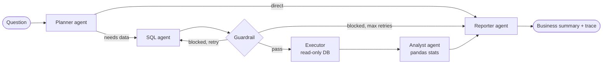

# Multi-Agent Analyst

An orchestrated team of LLM agents that answers business questions over a SQL database — safely.
Built with **LangGraph** and **Amazon Bedrock**, with read-only SQL guardrails and a per-agent execution trace for observability.

> Portfolio project inspired by my work leading agent-based analytics at a fintech. All data here is **synthetic**; no proprietary code or data is included.

## Architecture



| Agent | Role |
|---|---|
| **Planner** | Routes the question: database lookup or direct answer |
| **SQL agent** | Turns the question into a SQLite query, given the schema |
| **Guardrail** | Allows only single read-only `SELECT`s on allowed tables, blocks PII columns, enforces a row limit; on failure the SQL agent retries with the error as feedback |
| **Executor** | Runs the query on a read-only connection |
| **Analyst** | Computes descriptive statistics on the result |
| **Reporter** | Writes a concise business summary grounded only in the returned data |

Every step appends to a `trace` with latency, input/output tokens and model — ready to ship to Datadog or Langfuse (see [llm-observability-kit](https://github.com/Sombory/llm-observability-kit)).

## Quickstart

```bash
pip install -r requirements.txt

# Offline demo (no AWS needed)
LLM_PROVIDER=mock python -m analyst "Which segment has the highest churn rate?" --trace

# With Amazon Bedrock
cp .env.example .env   # set AWS_REGION / BEDROCK_MODEL_ID, use your AWS profile for credentials
python -m analyst "How did total spend evolve month by month?"
```

Example output:

```
SQL: SELECT segment, ROUND(AVG(churned)*100, 2) AS churn_rate_pct, COUNT(*) AS customers
     FROM customers GROUP BY segment ORDER BY churn_rate_pct DESC LIMIT 200

segment   churn_rate_pct  customers
emerging           31.62        468
merchant           29.19        209
...
```

## Tests

```bash
LLM_PROVIDER=mock pytest -q
```

Tests cover the guardrails (write/DDL blocking, multi-statement injection, table allow-list) and the full agent graph, including the retry-then-refuse path when an agent produces unsafe SQL.

## Stack

Python · LangGraph · Amazon Bedrock (Converse API) · SQLite · pandas · pytest

## Roadmap

- Chart agent (matplotlib/Plotly) for visual answers
- Evaluation set of question → expected-SQL pairs
- MCP server exposing the analyst as a tool
